<p align="center"></p>

<p align="center"><a href="README.md">Русский</a> · <b>English</b> · <a href="https://dufusxd.github.io/lazeyka/en/">Website</a></p>

<p align="center">
  <a href="https://github.com/DUFUSxD/lazeyka/releases/latest"></a>
  
  
  
  <a href="LICENSE"></a>
</p>

# Lazeyka

**A VPN for your browser only — through your own servers.** Paste your subscription link, press the big green button, and websites open through your VPN. Everything else on the computer (games, messengers, system updates) keeps working directly, as usual.

Works on **Windows 10 and 11**, **macOS** and **Linux** in **Google Chrome**, **Microsoft Edge**, **Brave**, **Yandex Browser** and other Chromium-based browsers. Free and open source, no admin rights needed. *Lazeyka* is Russian for “a loophole”.

<p align="center">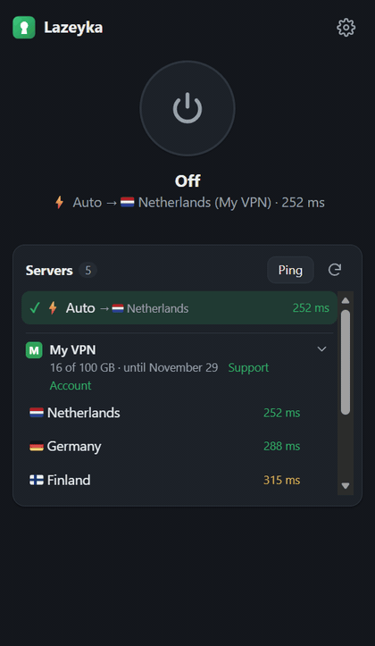</p>

## Contents

- [What it is and who it's for](#what-it-is-and-who-its-for)
- [How it differs from v2rayN, Hiddify and VPN extensions](#how-it-differs-from-v2rayn-hiddify-and-vpn-extensions)
- [What you need](#what-you-need)
- [Install — 5 minutes](#install--5-minutes)
- [How to use it](#how-to-use-it)
- [Which sites go via VPN](#which-sites-go-via-vpn)
- [Updates](#updates)
- [Moving to another computer](#moving-to-another-computer)
- [FAQ](#faq)
- [Troubleshooting](#troubleshooting)
- [Uninstall](#uninstall)
- [Security and privacy](#security-and-privacy)
- [For developers](#for-developers)

## What it is and who it's for

You have a VPN subscription — from a provider, from a friend who runs a server, or your own panel (3x-ui, Marzban, Remnawave). It's a link like `https://…/sub/…`. Usually you paste it into apps like v2rayN or Hiddify, and then **the whole computer** goes through the VPN.

Lazeyka does the same, but **for the browser only**, and decides which sites go through the VPN:

- **Your list of sites — via VPN or direct**, and a dedicated server for a specific site (say, ChatGPT always via the US).
- **For users in Russia, ready-made defaults:** Russian banks, government services, marketplaces — direct (they dislike foreign IPs); sites blocked in Russia (~1200, the list updates itself) — via VPN.
- **Everything else** — the way you set it.

All popular protocols are supported: VLESS (including Reality), VMess, Trojan, Shadowsocks, Hysteria2, TUIC.

## How it differs from v2rayN, Hiddify and VPN extensions

| | **Lazeyka** | v2rayN, Hiddify, Happ on a PC | VPN extensions from the store |
|---|---|---|---|
| What goes via VPN | the browser only, with per-site rules | the whole computer, or every app that uses the system proxy | the browser only |
| Whose servers | **your subscriptions** | your subscriptions | the extension's own servers |
| Local banks and services | direct — preconfigured for Russia | configurable with routing rules | usually via VPN as well |
| Protocols | VLESS/Reality, VMess, Trojan, Shadowsocks, Hysteria2, TUIC | the same | usually just their own |
| A dedicated server for one site | two clicks from the site card | in routing rules | rarely |

If you need games, Telegram or torrents to go through the VPN, you want a whole-computer app. If you only need the browser and want everything else untouched — that's Lazeyka.

## What you need

1. A Windows 10/11, macOS or Linux computer.
2. A Chromium-based browser: Chrome, Edge, Brave or Yandex Browser. Firefox and Safari won't work.
3. **A subscription link.**
   <details>
   <summary>Where to get it and what it looks like</summary>

   Wherever you got your VPN: your provider's account page, a Telegram bot, or whoever set up your server. Look for “Subscription” or “Link for v2rayN / Hiddify / Clash”.

   A correct link starts with `https://`, for example `https://panel.example.com/sub/a1b2c3d4`.
   If all you have is a line like `vless://…` or `vmess://…`, that's a key for a single server, not a subscription — ask your provider for the subscription link.
   </details>
4. About five minutes.

## Install — 5 minutes

### Step 1. Install the core with one command

**Windows**

1. Press **Win + X** and choose **“Terminal”** (on older Windows 10 — **“Windows PowerShell”**).
2. Copy the command (hover over it — a copy button appears on the right):
   ```powershell
   irm https://raw.githubusercontent.com/DUFUSxD/lazeyka/main/install.ps1 | iex
   ```
3. Right-click inside the terminal window (or press **Ctrl + V**) to paste it, then press **Enter**.
4. Wait 10–30 seconds. The installer talks in Russian — when you see the green **«Готово»** (“Done”), it's finished. An Explorer window with the `extension` folder opens by itself — you'll need it in the next step.

> 💡 **Don't copy anything yet.** The installer put a secret key into your clipboard; you'll need it in step 3. If you did copy something — no problem, see below where to find it.

<details>
<summary>What exactly the command did</summary>

- downloaded Lazeyka to `%LOCALAPPDATA%\Lazeyka`;
- downloaded the **mihomo** core — an open-source program that connects to VPN servers — from the project's official GitHub page;
- generated a random secret — the password the extension uses to control the core — and copied it to the clipboard;
- started the core in the background and added it to startup, so it runs with Windows.

Everything is per-user — no admin rights needed.
</details>

**macOS and Linux**

1. Open a terminal: on macOS — **Cmd + Space**, type “Terminal”, press Enter; on Linux — usually **Ctrl + Alt + T**.
2. Paste the command and press **Enter**:
   ```sh
   curl -fsSL https://raw.githubusercontent.com/DUFUSxD/lazeyka/main/install.sh | sh
   ```
3. In half a minute you'll see **«Готово»** (“Done”) and the secret. On macOS it's already in the clipboard; on Linux too if `wl-copy` or `xclip` is installed — otherwise copy it from the terminal window.

Lazeyka goes to `~/Lazeyka`, the core starts by itself when you log in (macOS — LaunchAgent, Linux — `systemd --user`). No admin rights needed. macOS may show a “Background Items Added” notification mentioning `mihomo` — that is Lazeyka's core and it is expected. Don't switch it off in Login Items, or the core won't start by itself after a reboot.

### Step 2. Add the extension to your browser

1. Open the extensions page — paste into the address bar and press Enter:
   - Chrome: `chrome://extensions`
   - Edge: `edge://extensions`
   - Brave: `brave://extensions`
   - Yandex Browser: `browser://extensions`
2. Turn on **“Developer mode”** (Chrome — top right, Edge — bottom left).
3. Click **“Load unpacked”**.
4. Pick the `extension` folder. The easiest way is to paste the path right in the folder dialog:
   - Windows: paste `%LOCALAPPDATA%\Lazeyka\extension` into the dialog's address bar, press Enter, then **“Select Folder”**;
   - macOS: **Cmd + Shift + G** → `~/Lazeyka/extension` → Enter → **“Select”**;
   - Linux: **Ctrl + L** → `~/Lazeyka/extension` → Enter → **“Open”**.

<p align="center">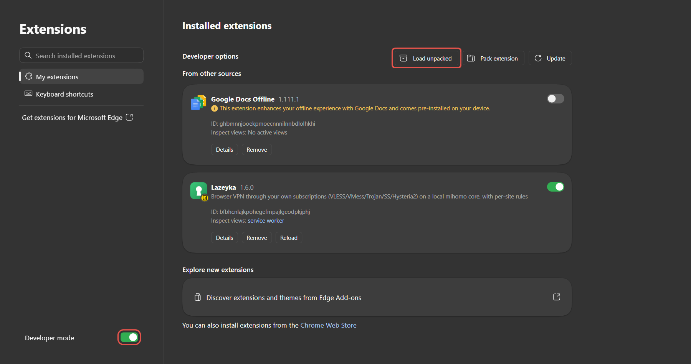</p>

5. Pin the icon so it's always at hand: click the puzzle icon 🧩 next to the address bar and the pin 📌 next to “Lazeyka”.

> The browser may sometimes suggest turning off “developer mode extensions” — click “Keep” or just close the warning. It does this for every extension not from the store.

### Step 3. Paste the secret and your subscription

<table><tr>
<td width="50%" valign="top">

1. Click the Lazeyka icon and then **“Open settings”**.
2. Click the **Secret** field and press **Ctrl + V**.
   <details><summary>Clipboard has something else?</summary>

   Open `%LOCALAPPDATA%\Lazeyka\core\config.yaml` in Notepad (paste this path into Explorer's address bar) and copy the value after `secret:` — without quotes. On macOS and Linux the file is `~/Lazeyka/core/config.yaml`.
   </details>
3. In **Subscriptions** paste your `https://…` link. Several subscriptions — one per line. You can put a name before the link, e.g. `My VPN https://…` — it will show in the server list.
4. Click **“Save”** — the server list appears.
5. Press the big round button. It turned green — **done!** 🎉

The interface language follows your browser; switch it in ⚙ → **“Language · Язык”**.

</td>
<td width="25%" valign="top">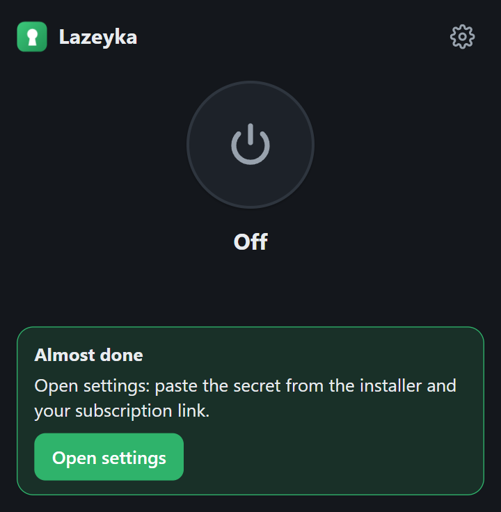</td>
<td width="25%" valign="top">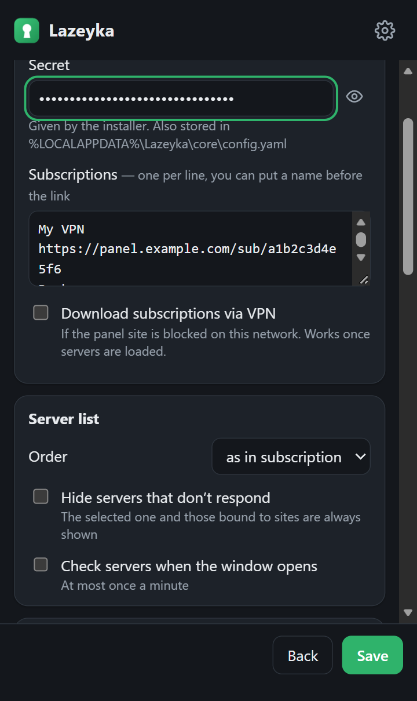</td>
</tr></table>

## How to use it

<p align="center">
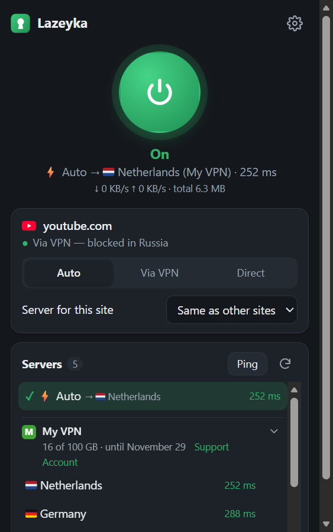
&nbsp;&nbsp;
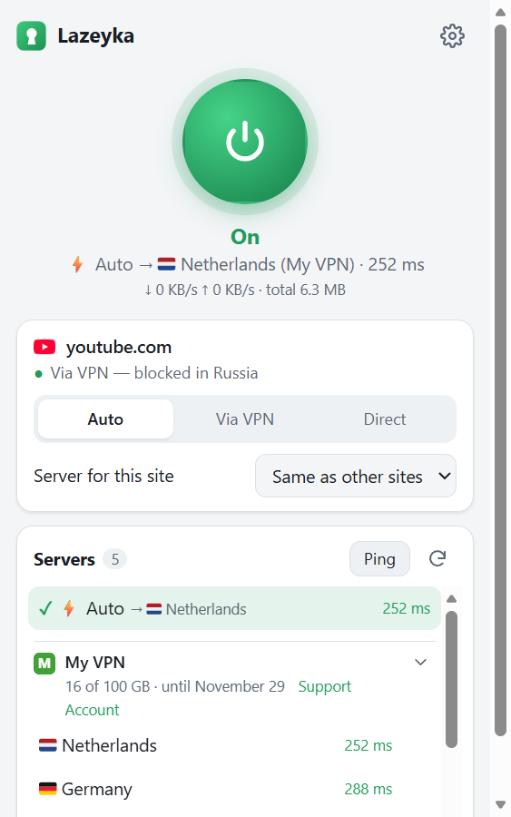
</p>

- **The big button** turns it on or off. Same with **Alt + Shift + L**.
- **Below the button** you see the current server and its latency, and when it's on — the speed and the total traffic through the VPN since the core started (“direct” sites aren't counted).
- **The toolbar icon:** green — on, grey — off, red “!” — something's wrong; open Lazeyka to see what to do.
- Light or dark theme follows your system.

### Choosing a server

- **⚡ Auto** — recommended. Picks the fastest working server and switches if the current one breaks or gets blocked.
- Click a specific server to use it instead.
- Numbers on the right are latency in milliseconds: green — great, yellow — fine, red — slow; “no response” — the server is down right now.
- **“Ping”** re-checks all servers. **⟳** updates subscriptions.
- **Servers are grouped by subscription.** Each has a logo, a name and, below it, used traffic and the expiry date if the panel reports them. When traffic is almost out or the subscription is about to expire, the line turns orange and the system shows a notification: 3 days before, on the day, and at 90% traffic.
- **Search** (shown with nine or more servers) understands countries in English and Russian: “Britain”, “England”, “UK” or “London” find “🇬🇧 London”, “UK-1” and “United Kingdom” alike. Same for “USA”, “Germany”, “Holland” and major cities.
- **Collapse a subscription** by clicking its header or the arrow on the right; Lazeyka remembers it.
- **Speed test.** Hover over a server and click **⇣** — Lazeyka downloads a test file through that server and shows Mbit/s without switching your current server. Works while Lazeyka is on and uses up to 25 MB of your subscription traffic.
- ⚙ → **“Server list”**: order (as in subscription, by ping, by name), **“Hide servers that don't respond”** and **“Check servers when the window opens”**.

### Provider data

Many panels (Remnawave, 3x-ui and others) report the subscription name, support and account links, and sometimes announcements like “maintenance tonight”. To show them, click ⚙ → **“Connection”** → **“Allow”**: the browser will ask for access to your panel's site. Then:

- the provider's name replaces the panel address in the server list (your own name wins);
- **“Support”** and **“Account”** links appear next to the expiry date;
- the logo is taken from the account site — usually the provider's main website;
- provider announcements show as a banner until you close it;
- the subscription refreshes as often as the provider asks;
- if the provider moved the subscription to a new address, Lazeyka switches by itself and notifies you.

Without the permission everything works as before, just without these extras.

### Open site card

Shows how the site you're on is opened and why: “Via VPN — blocked in Russia”, “Direct — Russian site”, and so on. Three buttons:

- **Auto** — the rules from settings decide (default);
- **Via VPN** — this site always goes via VPN;
- **Direct** — this site never uses the VPN (handy for a work portal that blocks VPNs).

The page reloads by itself.

### A dedicated server for a site

<table><tr>
<td valign="top">

For example, ChatGPT and Claude always via the US, everything else via ⚡ Auto.

1. Open the site.
2. Click the Lazeyka icon.
3. In the site card pick **“Server for this site”**.

All such bindings are listed in settings, where you can remove them. If the server disappears from the subscription, the site **won't open** (instead of bypassing the VPN), and the card suggests picking another one.

</td>
<td width="300" valign="top">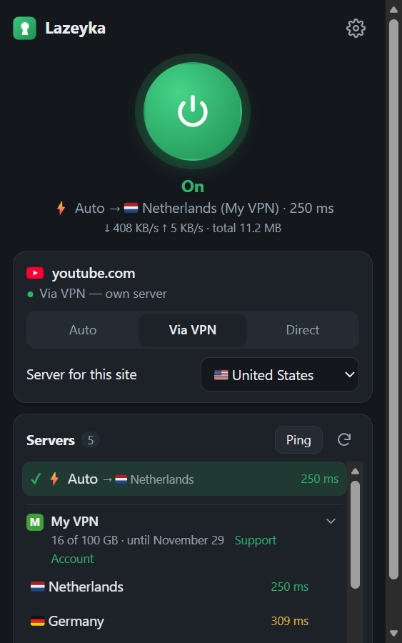</td>
</tr></table>

## Which sites go via VPN

<table><tr>
<td valign="top">

**By default:**
- Russian sites (.ru, .рф, .su, Yandex, VK, Sber, Gosuslugi…) — **direct**;
- sites blocked in Russia (~1200, the list updates itself) — **via VPN**;
- everything else — **via VPN**;
- your home network (router, printer, NAS) — always direct.

Change it in settings (⚙ top right) → **“Which sites go via VPN”**. There are also two lists of your own: **“Always via VPN”** and **“Always direct”** — one site per line.

- You can paste a full link (`https://www.youtube.com/watch?v=…`) — Lazeyka keeps just the site address.
- A site covers its subdomains: `google.com` includes `mail.google.com`.
- When several rules match, the most specific one wins: `google.com` direct and `gemini.google.com` via VPN works as expected.

Not in Russia? Turn off “Russian sites direct” and “Sites blocked in Russia — via VPN”, and use your own lists.

</td>
<td width="300" valign="top">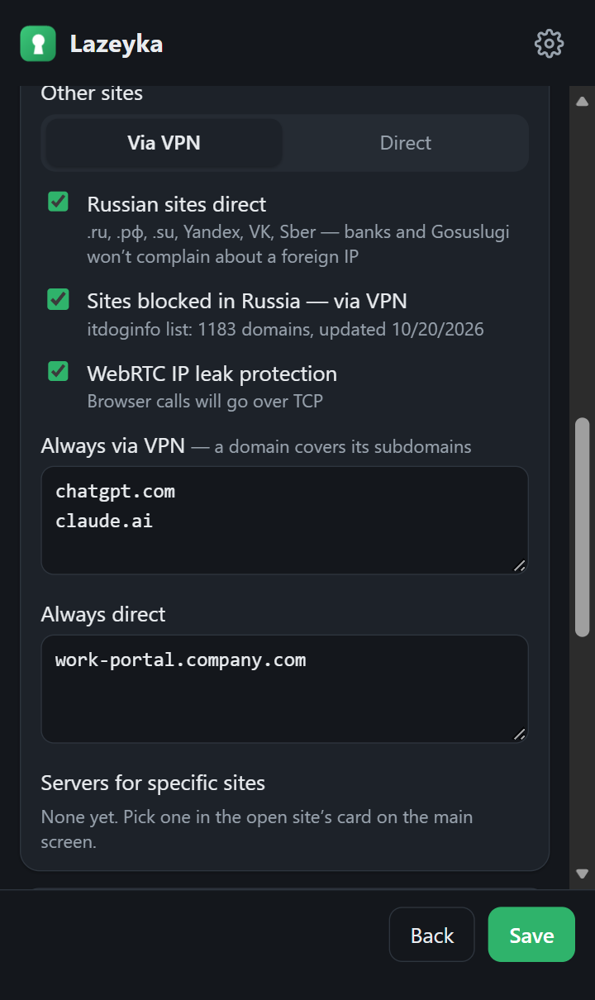</td>
</tr></table>

### Presets

| I want | “Other sites” | Russian sites direct | Blocked in Russia via VPN |
|---|---|---|---|
| **Everything via VPN, but banks and Gosuslugi work** (default) | Via VPN | ✅ | ✅ |
| **Only blocked sites via VPN** — fastest, least traffic | Direct | ✅ | ✅ |
| **Only my sites via VPN** | Direct | doesn't matter | ❌ — and fill in “Always via VPN” |
| **Absolutely everything via VPN** | Via VPN | ❌ | ✅ |

## Updates

<table><tr>
<td valign="top">

Lazeyka checks for new versions by itself. When one is out, you get a notification and a green banner in the Lazeyka window.

Click **“Update”** — in a couple of seconds Lazeyka restarts as the new version. Settings, subscriptions and the secret are kept. Nothing to download or copy.

Check manually: ⚙ → **“Checks and updates”** → **“Check now”**. All versions and what changed are on the [Releases](https://github.com/DUFUSxD/lazeyka/releases) page (in Russian).

> One-click updates haven't been tested in Yandex Browser and Brave yet. If the button shows a command instead, just run it as described in the window.

</td>
<td width="300" valign="top">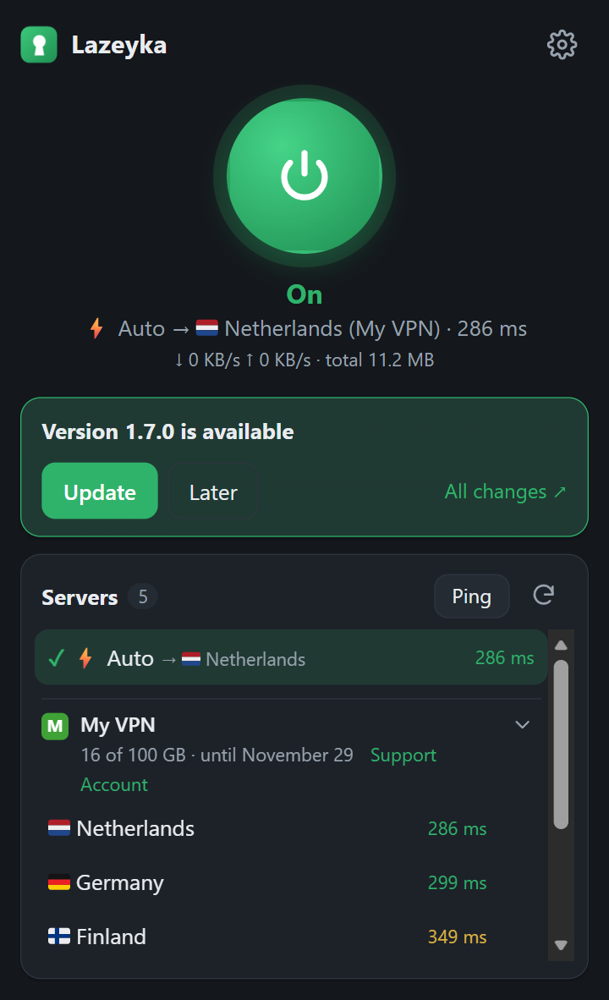</td>
</tr></table>

### How often to check

<table><tr>
<td valign="top">

In ⚙ → **“Checks and updates”**:

- **Check servers** — how often Lazeyka pings all servers: from every minute to once an hour (default — every 5 minutes). More often — ⚡ Auto notices a dead server and switches sooner; less often — fewer extra requests.
- **Check for updates** — from every hour to once a week (default — every 6 hours) or **“manually only”**: then Lazeyka doesn't contact GitHub at all until you click “Check now”.

</td>
<td width="300" valign="top">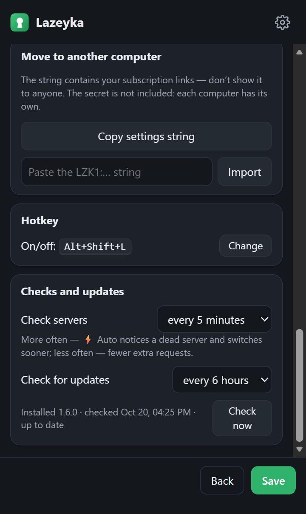</td>
</tr></table>

## Moving to another computer

1. **On the old computer:** ⚙ → **“Copy settings string”**. You get a long `LZK1:…` string with all subscriptions, site lists and per-site servers. Send it to yourself (e.g. Telegram “Saved Messages”).
   > ⚠️ The string contains your subscription links — don't publish it or send it to strangers.
2. **On the new computer:** do [steps 1 and 2 of the install](#install--5-minutes).
3. In Lazeyka: ⚙ → paste the string into **“Paste the LZK1:… string”** → **“Import”** → paste **this** computer's secret (it's in the clipboard after install) → **“Save”**.

Each computer has its own secret, so the string doesn't include it.

## FAQ

<details>
<summary><b>Can I use a VLESS / Reality subscription right in the browser?</b></summary>

Yes, that's exactly what Lazeyka is for. Browsers can't speak VLESS — extensions only get HTTP and SOCKS proxies — so a small mihomo core runs next to the browser and Lazeyka controls it. One command to install, everything else in the extension window.
</details>

<details>
<summary><b>Why not just use v2rayN, Hiddify or Happ on my PC?</b></summary>

With Lazeyka only the browser goes through the VPN. Games, Steam, torrents, system updates and work apps stay direct and don't eat your subscription traffic, and you can pick a server per site.
</details>

<details>
<summary><b>Will my Remnawave / 3x-ui / Marzban / Telegram-bot subscription work?</b></summary>

Yes — any `https://…` subscription link, in Clash/mihomo (YAML) format or as a base64 list of keys. If the subscription has a device limit, Lazeyka counts as a separate device, like a phone.
</details>

<details>
<summary><b>Is it free?</b></summary>

Yes, Lazeyka is free and open source (MIT). You only pay for your subscription to whoever provides it.
</details>

<details>
<summary><b>Where do my subscriptions go? Is it safe?</b></summary>

Nowhere: they stay in your browser and in the core on your computer. Lazeyka has no servers, accounts or telemetry. If the core crashes, VPN sites simply don't open instead of leaking your real IP. See [Security and privacy](#security-and-privacy).
</details>

<details>
<summary><b>Is there a version for Mac, Linux, Firefox or phones?</b></summary>

**macOS and Linux** — yes, with their own install command (see [step 1](#step-1-install-the-core-with-one-command)). **Firefox and Safari** — no: Lazeyka works in Chromium-based browsers.

**Phones** — not as an extension: mobile browsers don't let extensions control the proxy. On a phone, use free apps on the same mihomo core, such as FlClash or Clash Meta for Android; FlClash lets you choose which apps go through the VPN and keep just the browser.
</details>

<details>
<summary><b>Do I need admin rights?</b></summary>

No. Everything is installed for your user only: files go to your personal folder, autostart to your user settings. The core only accepts connections from the same computer (127.0.0.1), so the firewall doesn't ask anything.
</details>

<details>
<summary><b>Will it be in the Chrome or Edge store?</b></summary>

It's in the works. Even then the core has to be installed once with the command — stores install only the extension itself. For now the extension loads from a folder and updates with the “Update” button.
</details>

## Troubleshooting

<table><tr>
<td width="300" valign="top">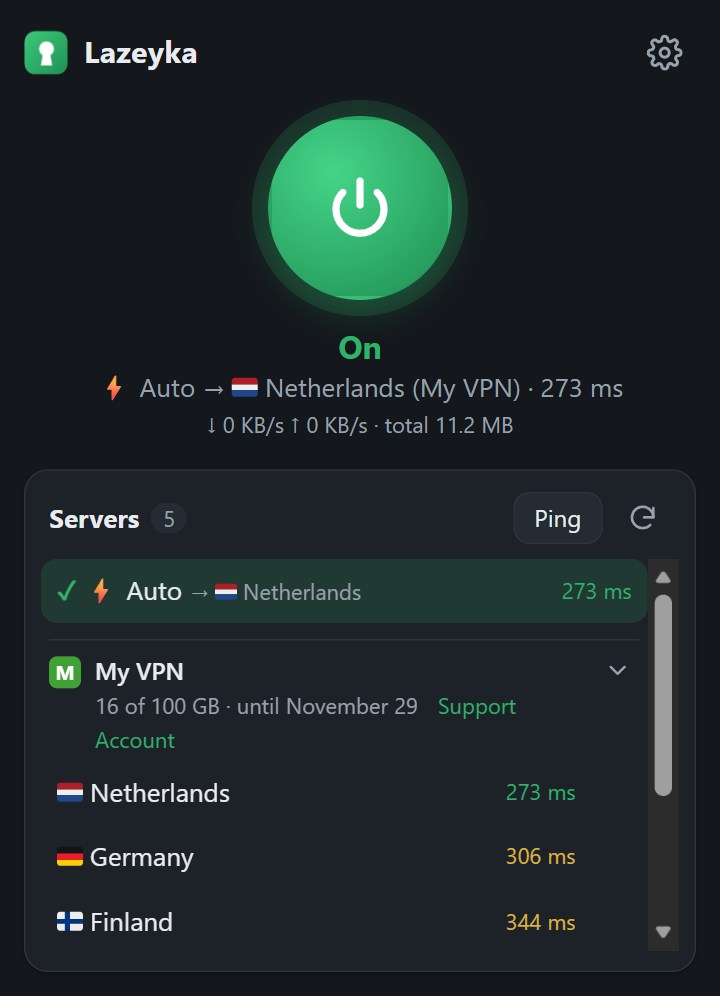</td>
<td valign="top">

**“The mihomo core is not running”.** Click **“Start core”**. Didn't help — click **“Copy command”**, then **Win + R**, **Ctrl + V**, **Enter** (on macOS and Linux — paste it into a terminal). Or just restart the computer — the core is in startup.

**“Wrong secret”.** Open `%LOCALAPPDATA%\Lazeyka\core\config.yaml` in Notepad (on macOS and Linux — `~/Lazeyka/core/config.yaml`) and copy the value after `secret:` (without quotes) into Lazeyka's settings.

**A subscription with a red “⚠ …” instead of servers.** It didn't download; the banner says why. If the subscription site is blocked on your network, Lazeyka downloads it through the servers of your other subscriptions (“via VPN” appears next to it). If there are no other working servers yet, click **“Download via VPN”** once they appear.

</td>
</tr></table>

| You see | What to do |
|---|---|
| “… doesn't respond from this network — it seems to be blocked here” | VPN providers' sites are often blocked. Lazeyka tries to download such a subscription via VPN by itself. |
| “… answered “not found” (404)” | The link is outdated, the subscription was deleted or expired, or its device limit is used up. Remove a device in your provider's account or get a fresh link. |
| “… denied access (403)” | The panel blocks this network or country. Lazeyka tries via VPN; if that fails, ask your provider. |
| “… is a single server key, but a subscription link is needed” | You pasted `vless://…` or `vmess://…`. You need a `https://…/sub/…` link — see [What you need](#what-you-need). |
| “All servers are unreachable”, every server shows “no response” | The servers are unreachable from this network, or the subscription ended. Contact your provider. |
| “The proxy is taken by another extension” | Another VPN or proxy extension is on. Turn it off on the extensions page — only one extension can control the proxy. |
| One specific site doesn't open | Open it, click the Lazeyka icon and choose **“Direct”** (or the other way round, **“Via VPN”**). |
| Browser calls (video calls) sound choppy | ⚙ → untick “WebRTC IP leak protection”. |
| Red text “irm is not recognized…” during install | The command went into “Command Prompt”; you need “Terminal” / PowerShell — see [step 1](#step-1-install-the-core-with-one-command). |
| Error downloading mihomo during install | GitHub is unreachable from this network. On another computer download `mihomo-windows-amd64-compatible-….zip` from the [releases page](https://github.com/MetaCubeX/mihomo/releases), unpack it and put the file at `%LOCALAPPDATA%\Lazeyka\core\mihomo.exe`, then run the command again. |
| Linux: “Update” and “Start core” do nothing | Most likely a Snap or Flatpak browser (e.g. the default Chromium on Ubuntu): such browsers can't start the external helper. The VPN works; run the commands from the window in a terminal — or install Chrome, Brave or Edge from a .deb / .rpm. |
| Antivirus complains about `mihomo.exe` | Some antiviruses distrust any proxy program. mihomo is open source and downloaded from its official GitHub. Restore it from quarantine or reinstall. |

Still stuck — open an [issue](https://github.com/DUFUSxD/lazeyka/issues) (a screenshot of the Lazeyka window helps a lot) or ask in [Discussions](https://github.com/DUFUSxD/lazeyka/discussions).

## Uninstall

1. On the extensions page click **“Remove”** for Lazeyka. The browser restores its normal network settings right away.
2. Remove the core and the helper.

   **Windows** — open **Terminal** (Win + X) and run:
   ```powershell
   Get-Process mihomo -ErrorAction SilentlyContinue | Where-Object Path -like "$env:LOCALAPPDATA\Lazeyka\*" | Stop-Process -Force
   Remove-ItemProperty HKCU:\Software\Microsoft\Windows\CurrentVersion\Run LazeykaMihomo -ErrorAction SilentlyContinue
   'Google\Chrome', 'Microsoft\Edge', 'Chromium', 'Yandex\YandexBrowser', 'BraveSoftware\Brave-Browser' | ForEach-Object { Remove-Item "HKCU:\Software\$_\NativeMessagingHosts\com.lazeyka.host" -ErrorAction SilentlyContinue }
   Remove-Item "$env:LOCALAPPDATA\Lazeyka" -Recurse -Force
   ```

   **macOS** — in Terminal:
   ```sh
   launchctl bootout "gui/$(id -u)/com.lazeyka.mihomo" 2>/dev/null; rm -f ~/Library/LaunchAgents/com.lazeyka.mihomo.plist
   rm -f ~/Library/Application\ Support/*/NativeMessagingHosts/com.lazeyka.host.json ~/Library/Application\ Support/*/*/NativeMessagingHosts/com.lazeyka.host.json
   rm -rf ~/Lazeyka
   ```

   **Linux** — in a terminal:
   ```sh
   systemctl --user disable --now lazeyka-mihomo 2>/dev/null; pkill -f Lazeyka/core/mihomo
   rm -f ~/.config/systemd/user/lazeyka-mihomo.service ~/.config/autostart/lazeyka-mihomo.desktop
   rm -f ~/.config/*/NativeMessagingHosts/com.lazeyka.host.json ~/.config/*/*/NativeMessagingHosts/com.lazeyka.host.json
   rm -rf ~/Lazeyka
   ```

## Security and privacy

- **Your subscriptions go nowhere.** They live only in your browser and the core on your computer. No telemetry, accounts or Lazeyka servers.
- **The core is reachable only from this computer** and only with a random secret — websites can't control it.
- **No leaks.** If the core crashes or all servers are down, sites that should use the VPN simply don't open instead of going out with your real address. WebRTC IP leaks are blocked too.
- **Updates come only from this repository.** The update helper can do exactly three things: report the version, start the core, and download the new version from here.
- **Subscription logos** load straight from your panels' sites, without third-party icon services.
- **Device ID.** For panels with a device limit, Lazeyka sends a random number generated on this computer and the model “Lazeyka”. It contains nothing about your computer and isn't included in the settings string.
- **The speed test** downloads a file from `speed.cloudflare.com`, always through the server being tested.

Found a vulnerability? Report it privately — see [SECURITY.md](SECURITY.md).

## For developers

How it works, how to change, test and release it — in [**docs/**](docs/README.md) (in Russian): [architecture](docs/architecture.md) · [development and tests](docs/development.md) · [releasing](docs/release.md) · [troubleshooting](docs/troubleshooting.md) · [design decisions](docs/decisions.md). Translations live in `extension/i18n.js` — the key is the Russian text, the English is in `EN`.

## Thanks

- [MetaCubeX/mihomo](https://github.com/MetaCubeX/mihomo) — the core that does all the work with servers.
- [itdoginfo/allow-domains](https://github.com/itdoginfo/allow-domains) — the list of sites blocked in Russia.
- Country flags — [Twemoji](https://github.com/twitter/twemoji) graphics (© Twitter, [CC-BY 4.0](https://creativecommons.org/licenses/by/4.0/)) as a font from [country-flag-emoji-polyfill](https://github.com/talkjs/country-flag-emoji-polyfill) (MIT).

## License

[MIT](LICENSE). Questions and ideas — in [Discussions](https://github.com/DUFUSxD/lazeyka/discussions).
