<p align="center">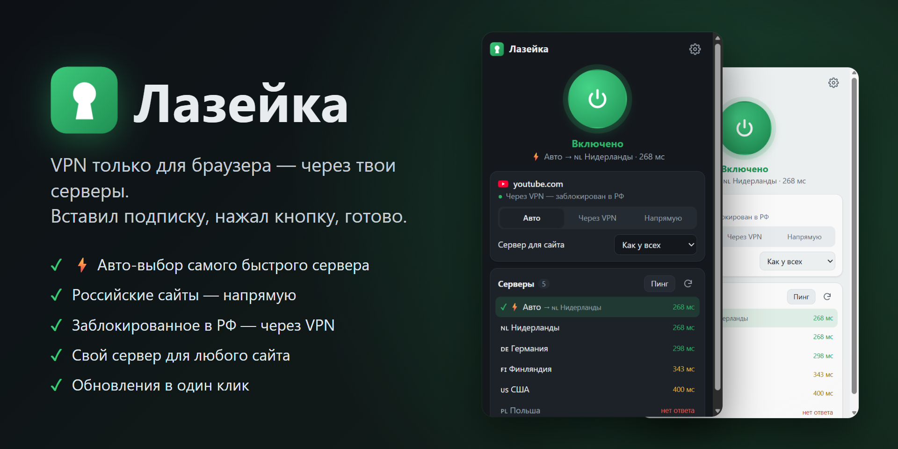</p>

<p align="center"><b>Русский</b> · <a href="README.en.md">English</a> · <a href="https://dufusxd.github.io/lazeyka/">Сайт</a></p>

<p align="center">
  <a href="https://github.com/DUFUSxD/lazeyka/releases/latest"></a>
  
  
  
  <a href="LICENSE"></a>
</p>

# Лазейка

**VPN только для браузера — через твои собственные серверы.** Вставляешь ссылку на подписку, нажимаешь большую зелёную кнопку — и сайты открываются через VPN. Всё остальное на компьютере (игры, мессенджеры, обновления Windows) работает как обычно, напрямую.

Работает на **Windows 10 и 11** в браузерах **Google Chrome**, **Microsoft Edge**, **Яндекс.Браузер** и других на основе Chromium. Бесплатно и с открытым кодом.

<p align="center">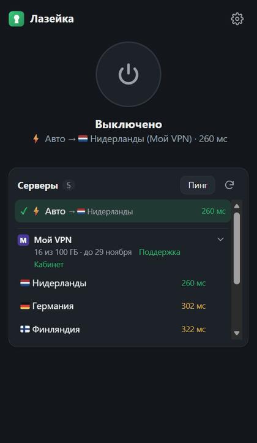</p>

## Содержание

- [Что это и кому подойдёт](#что-это-и-кому-подойдёт)
- [Чем отличается от v2rayN, Hiddify и VPN-расширений](#чем-отличается-от-v2rayn-hiddify-и-vpn-расширений)
- [Что понадобится](#что-понадобится)
- [Установка — 5 минут](#установка--5-минут)
- [Как пользоваться](#как-пользоваться)
- [Какие сайты идут через VPN](#какие-сайты-идут-через-vpn)
- [Обновления](#обновления)
- [Перенос на другой компьютер](#перенос-на-другой-компьютер)
- [Частые вопросы](#частые-вопросы)
- [Если что-то не работает](#если-что-то-не-работает)
- [Удаление](#удаление)
- [Безопасность и приватность](#безопасность-и-приватность)
- [Для разработчиков](#для-разработчиков)

## Что это и кому подойдёт

У тебя есть VPN-подписка — от провайдера, от друга-админа или своя панель (3x-ui, Marzban, Remnawave). Это ссылка вида `https://…/sub/…`. Обычно её вставляют в программы вроде v2rayN или Hiddify, и тогда через VPN идёт **весь** компьютер.

Лазейка делает то же самое, но **только для браузера**, и сама решает, какие сайты пускать через VPN:

- **Госуслуги, банки, Яндекс, VK, маркетплейсы — напрямую.** Им не нравятся зарубежные адреса, а так они просто работают.
- **YouTube, Instagram и другие заблокированные сайты — через VPN, автоматически.** Список из ~1200 сайтов обновляется сам.
- **Всё остальное** — как настроишь.

Поддерживаются все популярные протоколы: VLESS (в том числе Reality), VMess, Trojan, Shadowsocks, Hysteria2, TUIC.

## Чем отличается от v2rayN, Hiddify и VPN-расширений

| | **Лазейка** | v2rayN, Hiddify, Happ на компьютере | VPN-расширения из магазина |
|---|---|---|---|
| Что идёт через VPN | только браузер, по правилам для сайтов | весь компьютер или все программы, которые слушают системный прокси | только браузер |
| Чьи серверы | **твои подписки** | твои подписки | серверы самого расширения |
| Госуслуги, банки, маркетплейсы | напрямую — уже настроено | можно настроить правилами маршрутизации | обычно тоже через VPN |
| Заблокированные в РФ сайты | через VPN по готовому списку, обновляется сам | зависит от правил | всё подряд через VPN |
| Протоколы | VLESS/Reality, VMess, Trojan, Shadowsocks, Hysteria2, TUIC | те же | обычно только свой |
| Свой сервер для отдельного сайта | в два клика из карточки сайта | в правилах маршрутизации | редко |

Если нужно, чтобы через VPN шли игры, Telegram или торренты, — тебе нужна программа для всего компьютера. Если нужен только браузер, а остальное пусть работает как обычно, — это Лазейка.

## Что понадобится

1. Компьютер с Windows 10 или 11.
2. Браузер Chrome, Edge или Яндекс.Браузер.
3. **Ссылка на подписку.**
   <details>
   <summary>Где её взять и как она выглядит</summary>

   Там же, где ты получил VPN: в личном кабинете провайдера, в Telegram-боте или у того, кто настроил тебе сервер. Ищи кнопку «Подписка», «Subscription», «Ссылка для v2rayN / Hiddify / Clash».

   Правильная ссылка начинается с `https://`, например `https://panel.example.com/sub/a1b2c3d4`.
   Если у тебя только строка вида `vless://…` или `vmess://…` — это ключ от одного сервера, а не подписка. Попроси у провайдера именно ссылку на подписку.
   </details>
4. Минут пять.

## Установка — 5 минут

### Шаг 1. Установи ядро одной командой

1. Нажми на клавиатуре **Win + X** (клавиша с логотипом Windows и буква X одновременно). В появившемся меню выбери **«Терминал»** (на старых Windows 10 — **«Windows PowerShell»**).
2. Скопируй команду — наведи на неё мышку, справа появится кнопка копирования:
   ```powershell
   irm https://raw.githubusercontent.com/DUFUSxD/lazeyka/main/install.ps1 | iex
   ```
3. Щёлкни в окне терминала **правой кнопкой мыши** (или нажми **Ctrl + V**) — команда вставится. Нажми **Enter**.
4. Подожди 10–30 секунд. Побегут строки «Скачиваю Лазейку…», «Скачиваю mihomo…», а в конце появится зелёное **«Готово»**. Сам откроется проводник с папкой `extension` — она понадобится на следующем шаге.

> 💡 **Пока ничего не копируй.** Установщик положил в буфер обмена секретный ключ (secret), он понадобится на третьем шаге. Если всё-таки скопировал — не страшно, ниже написано, где его найти.

<details>
<summary>Что именно сделала команда</summary>

- скачала Лазейку в папку `%LOCALAPPDATA%\Lazeyka`;
- скачала ядро **mihomo** — программу с открытым кодом, которая умеет подключаться к VPN-серверам (с официальной страницы проекта на GitHub);
- придумала случайный secret — пароль, по которому расширение управляет ядром — и скопировала его в буфер обмена;
- запустила ядро в фоне и добавила его в автозагрузку, чтобы оно стартовало вместе с Windows.

</details>

### Шаг 2. Добавь расширение в браузер

1. Открой страницу расширений — скопируй в адресную строку браузера и нажми Enter:
   - Chrome: `chrome://extensions`
   - Edge: `edge://extensions`
   - Яндекс.Браузер: `browser://extensions`
2. Включи **«Режим разработчика»** (переключатель: в Chrome — справа вверху, в Edge — слева внизу).
3. Нажми **«Загрузить распакованное»**.
4. Выбери папку `extension`. Проще всего: в окне выбора папки вставь в адресную строку `%LOCALAPPDATA%\Lazeyka\extension`, нажми Enter, затем **«Выбор папки»**.

<p align="center">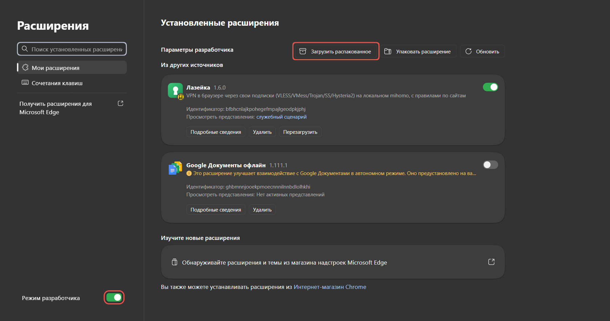</p>

5. Закрепи значок, чтобы он всегда был под рукой: нажми на значок пазла 🧩 справа от адресной строки и на булавку 📌 рядом с «Лазейкой».

> Браузер может иногда предлагать отключить «расширения в режиме разработчика» — нажимай «Оставить» или просто закрывай предупреждение. Так он делает со всеми расширениями не из магазина.

### Шаг 3. Вставь secret и подписку

<table><tr>
<td width="50%" valign="top">

1. Нажми на значок Лазейки и на кнопку **«Открыть настройки»**.
2. Щёлкни в поле **Secret** и нажми **Ctrl + V**.
   <details><summary>В буфере уже что-то другое?</summary>

   Открой в Блокноте файл `%LOCALAPPDATA%\Lazeyka\core\config.yaml` (вставь этот путь в адресную строку проводника) и скопируй значение после `secret:` — без кавычек.
   </details>
3. В поле **Подписки** вставь свою ссылку `https://…`. Если подписок несколько — каждую с новой строки. Перед ссылкой можно написать название, например `Мой VPN https://…` — оно будет в списке серверов (без названия там будет адрес сайта панели).
4. Нажми **«Сохранить»** — появится список серверов.
5. Нажми большую круглую кнопку. Она стала зелёной — **готово!** 🎉

</td>
<td width="25%" valign="top">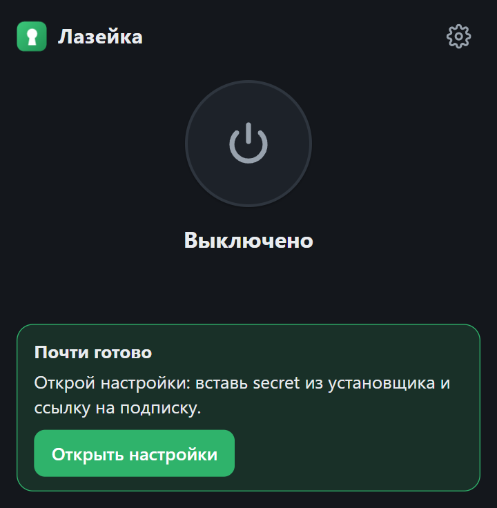</td>
<td width="25%" valign="top">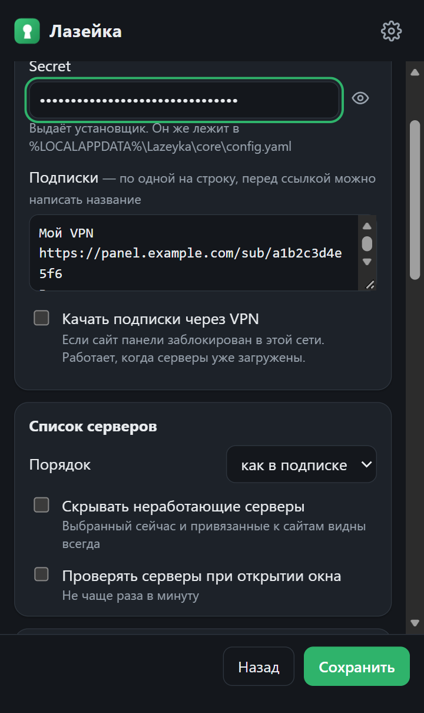</td>
</tr></table>

## Как пользоваться

<p align="center">
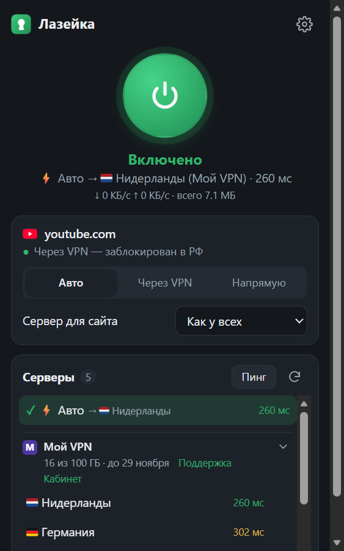
&nbsp;&nbsp;
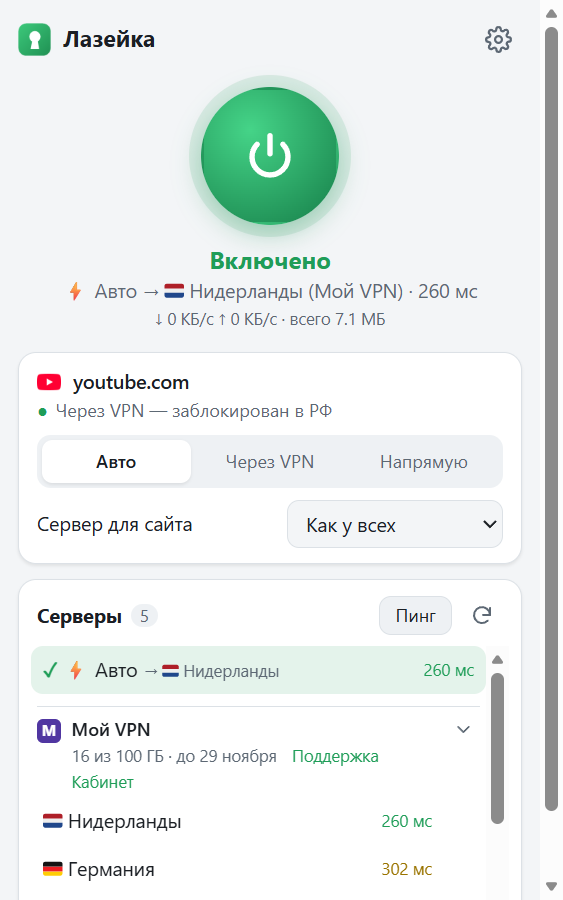
</p>

- **Большая кнопка** — включить или выключить. То же самое — сочетание клавиш **Alt + Shift + L**.
- **Под кнопкой** видно, через какой сервер ты сейчас ходишь и какая у него задержка, а когда Лазейка включена — скорость и сколько всего прошло через VPN с запуска ядра — обычно с включения компьютера (сайты «напрямую» сюда не входят).
- **Значок на панели браузера:** зелёный — включено, серый — выключено, красный «!» — что-то не так. Открой Лазейку — там написано, что делать.
- Тема (светлая или тёмная) подстраивается под Windows сама.
- **Язык** — русский или английский: ⚙ → **«Язык · Language»**. По умолчанию — как у браузера (у тех, кто обновился со старой версии, остаётся русский).

### Выбор сервера

- **⚡ Авто** — рекомендуем. Сам выбирает самый быстрый работающий сервер и переключается, если текущий сломался или его заблокировали.
- Можно нажать на конкретный сервер — тогда будешь ходить через него.
- Цифры справа — задержка в миллисекундах: чем меньше, тем быстрее. Зелёные — отлично, жёлтые — нормально, красные — медленно. «нет ответа» — сервер сейчас не работает.
- **«Пинг»** — проверить все серверы заново. **⟳** — обновить подписки.
- **Серверы сгруппированы по подпискам.** У каждой — логотип (значок сайта панели или цветной кружок с буквой), название, а строкой ниже — сколько трафика израсходовано и до какого числа действует подписка, если панель это сообщает. Когда трафик почти кончился или срок вот-вот истечёт, строка подсвечивается, а Windows покажет уведомление: за 3 дня до конца, в день окончания и когда израсходовано 90% трафика.
- Если подписок несколько, под большой кнопкой рядом с сервером написано, из какой он подписки.
- **Поиск** (появляется, когда серверов девять и больше) понимает страны на русском и английском: «Британия», «Англия», «UK» или «Лондон» найдут и «🇬🇧 London», и «UK-1», и «United Kingdom». Так же «США», «Германия», «Голландия» и крупные города.
- **Свернуть подписку** — нажми на её шапку или стрелку справа: серверы спрячутся, останется «N серверов». Лазейка это запомнит. При поиске свёрнутые подписки временно раскрываются.
- **Тест скорости.** Наведи на сервер и нажми **⇣** справа — Лазейка скачает тестовый файл через этот сервер и покажет скорость в Мбит/с. Текущий сервер при этом не меняется. Тест работает, когда Лазейка включена, и тратит до 25 МБ трафика подписки.
- ⚙ → **«Список серверов»**: порядок (как в подписке, по пингу, по названию), **«Скрывать неработающие»** (выбранный сейчас и привязанные к сайтам видны всегда) и **«Проверять серверы при открытии окна»**.

### Данные от провайдера

Многие панели (Remnawave, 3x-ui и другие) сообщают название подписки, ссылку на поддержку и личный кабинет, а иногда — объявления вроде «плановые работы ночью». Чтобы Лазейка их показывала, нажми ⚙ → **«Подключение»** → **«Разрешить»**: браузер спросит разрешение на сайт твоей панели. После этого:

- в списке серверов вместо адреса сайта — название от провайдера (своё название, если ты его написал, важнее);
- рядом со сроком — ссылки **«Поддержка»** и **«Кабинет»**;
- логотип берётся с сайта кабинета — обычно это основной сайт провайдера, а подписку часто отдают с технического адреса без значка;
- объявления провайдера появляются плашкой в окне Лазейки, пока не закроешь ✕;
- подписка обновляется так часто, как просит провайдер;
- если провайдер переехал на новый адрес и сообщил его, Лазейка переключится сама и пришлёт уведомление.

Без разрешения всё работает как раньше — просто без этих мелочей.

### Карточка открытого сайта

Показывает, как сейчас открывается сайт, на котором ты находишься, и почему: «Через VPN — заблокирован в РФ», «Напрямую — российский сайт» и так далее. Три кнопки:

- **Авто** — решают общие правила (так по умолчанию);
- **Через VPN** — этот сайт всегда через VPN;
- **Напрямую** — этот сайт всегда без VPN. Пригодится, если какой-то сайт (например, рабочий портал) не открывается через VPN.

После нажатия страница сама перезагрузится.

### Свой сервер для сайта

<table><tr>
<td valign="top">

Например, ChatGPT и Claude — всегда через США, а всё остальное — через ⚡ Авто.

1. Открой нужный сайт.
2. Нажми на значок Лазейки.
3. В карточке сайта выбери **«Сервер для сайта»**.

Все такие привязки видны в настройках, там же их можно удалить. Если сервер пропадёт из подписки, сайт **не откроется** (а не пойдёт мимо VPN), и в карточке появится подсказка выбрать другой.

</td>
<td width="300" valign="top">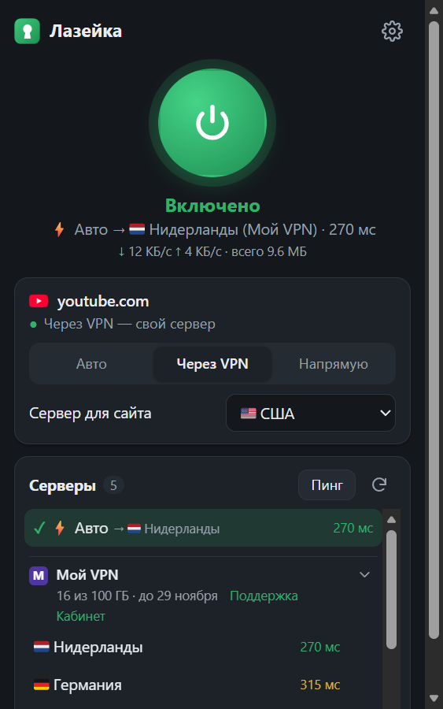</td>
</tr></table>

## Какие сайты идут через VPN

<table><tr>
<td valign="top">

**По умолчанию:**
- российские сайты (.ru, .рф, .su, Яндекс, VK, Сбер, Госуслуги…) — **напрямую**;
- заблокированные в РФ (~1200 сайтов, список обновляется сам) — **через VPN**;
- все остальные — **через VPN**;
- домашняя сеть (роутер, принтер, NAS) — всегда напрямую.

Всё это меняется в настройках (⚙ справа вверху) → **«Какие сайты через VPN»**. Там же два своих списка: **«Всегда через VPN»** и **«Всегда напрямую»** — по одному сайту на строку.

- Можно вставлять ссылку целиком (`https://www.youtube.com/watch?v=…`) — Лазейка сама оставит только адрес сайта.
- Сайт в списке действует и на все его поддомены: `google.com` — это ещё и `mail.google.com`.
- Если сайт подходит под несколько правил, побеждает самое точное. Например, `google.com` напрямую, а `gemini.google.com` через VPN — так и будет.

</td>
<td width="300" valign="top">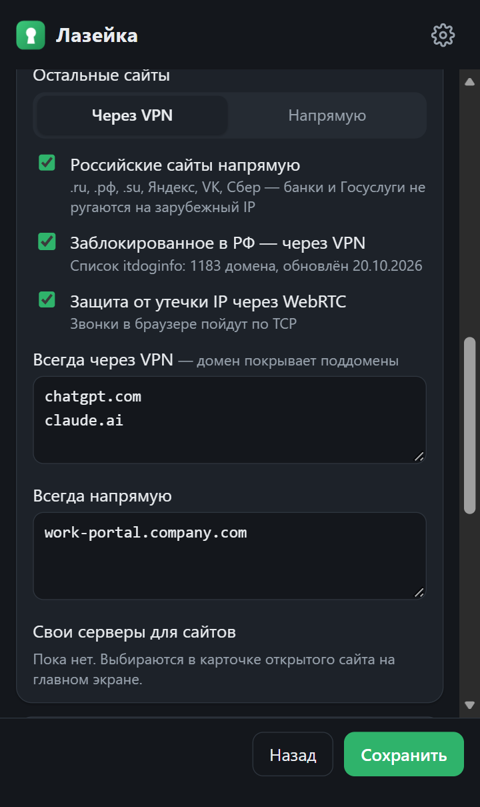</td>
</tr></table>

### Готовые варианты

| Хочу | «Остальные сайты» | Российские напрямую | Заблокированное через VPN |
|---|---|---|---|
| **Всё через VPN, но банки и Госуслуги работают** (так по умолчанию) | Через VPN | ✅ | ✅ |
| **Только заблокированное через VPN** — быстрее всего, меньше расход трафика | Напрямую | ✅ | ✅ |
| **Только мои сайты через VPN** | Напрямую | неважно | ❌ — и заполни «Всегда через VPN» |
| **Вообще всё через VPN** | Через VPN | ❌ | ✅ |

## Обновления

<table><tr>
<td valign="top">

Лазейка сама проверяет, не вышла ли новая версия. Когда выходит — приходит уведомление, а в окне Лазейки появляется зелёная плашка со списком изменений.

Нажми **«Обновить»** — через пару секунд Лазейка перезапустится уже новой версией. Настройки, подписки и secret сохраняются. Ничего скачивать и копировать не нужно.

Проверить вручную: ⚙ → **«Проверки и обновления»** → **«Проверить сейчас»**. Все версии и что в них изменилось — на странице [Releases](https://github.com/DUFUSxD/lazeyka/releases).

> В Яндекс.Браузере и Brave обновление в один клик пока не проверялось. Если кнопка вместо обновления покажет команду — просто выполни её, как написано в окне.

> **У тебя версия 1.0 или 1.1?** В них кнопки обновления ещё нет. Один раз выполни команду из [шага 1](#шаг-1-установи-ядро-одной-командой), затем на странице расширений нажми **«Перезагрузить»** у Лазейки. Дальше обновления — в один клик.

</td>
<td width="300" valign="top">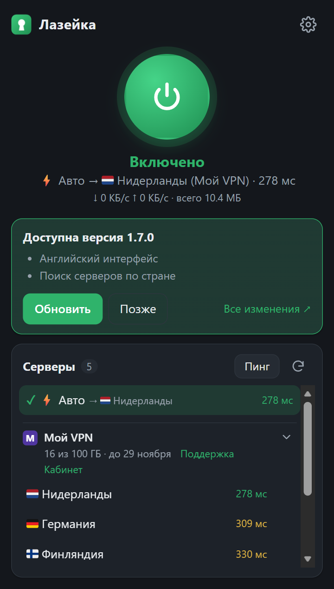</td>
</tr></table>

### Как часто проверять

<table><tr>
<td valign="top">

В ⚙ → **«Проверки и обновления»** можно выбрать:

- **Проверять серверы** — как часто Лазейка пингует все серверы: от раза в минуту до раза в час (по умолчанию каждые 5 минут). Чаще — ⚡ Авто быстрее заметит упавший сервер и переключится; реже — меньше лишних запросов.
- **Искать обновления** — от раза в час до раза в неделю (по умолчанию каждые 6 часов) или **«только вручную»**: тогда Лазейка вообще не обращается к GitHub, пока ты сам не нажмёшь «Проверить сейчас».

</td>
<td width="300" valign="top">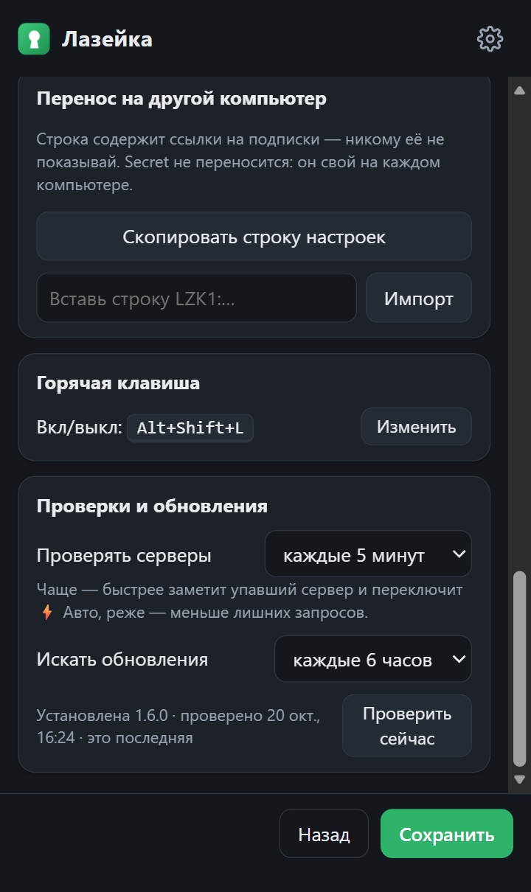</td>
</tr></table>

## Перенос на другой компьютер

1. **На старом компьютере:** ⚙ → **«Скопировать строку настроек»**. Получится длинная строка `LZK1:…` со всеми подписками, списками сайтов и своими серверами. Перешли её себе — например, в «Избранное» в Telegram.
   > ⚠️ В строке есть ссылки на твои подписки — не публикуй её и не отправляй посторонним.
2. **На новом компьютере:** выполни [шаги 1 и 2 установки](#установка--5-минут).
3. В Лазейке: ⚙ → вставь строку в поле **«Вставь строку LZK1:…»** → **«Импорт»** → вставь в поле Secret ключ **этого** компьютера (он в буфере обмена после установки) → **«Сохранить»**.

Secret на каждом компьютере свой, поэтому строка его не содержит.

Что нужно от интернета на новом месте:
- один раз — доступ к GitHub, чтобы скачать ядро (если GitHub там закрыт — см. [ниже](#если-что-то-не-работает));
- хотя бы одна подписка должна скачиваться без VPN. Если сайт какой-то подписки там заблокирован, Лазейка скачает её через серверы остальных;
- доступ к самим VPN-серверам.

## Частые вопросы

<details>
<summary><b>Можно ли пользоваться подпиской VLESS / Reality прямо в браузере?</b></summary>

Да, для этого Лазейка и сделана. Сами браузеры VLESS не понимают — расширениям доступны только HTTP- и SOCKS-прокси, — поэтому рядом работает маленькое ядро mihomo, а Лазейка им управляет. Ставится одной командой, дальше всё в окне расширения.
</details>

<details>
<summary><b>Чем это удобнее v2rayN, Hiddify или Happ на компьютере?</b></summary>

Через VPN идёт только браузер. Игры, Steam, торренты, обновления Windows и рабочие программы ходят напрямую и не тратят трафик подписки. Госуслуги, банки и маркетплейсы открываются напрямую без настройки. А сервер можно выбрать отдельно для каждого сайта.
</details>

<details>
<summary><b>Подойдёт ли моя подписка от Remnawave, 3x-ui, Marzban или из Telegram-бота?</b></summary>

Да — любая ссылка на подписку вида `https://…`: в формате Clash/mihomo (YAML) или списком ключей в base64. Если у подписки лимит устройств, Лазейка считается отдельным устройством — как телефон.
</details>

<details>
<summary><b>Это бесплатно?</b></summary>

Да, Лазейка бесплатная и с открытым кодом (лицензия MIT). Платишь только за свою подписку — тому, у кого её берёшь.
</details>

<details>
<summary><b>Куда уходят мои подписки? Это безопасно?</b></summary>

Никуда: они хранятся в браузере и в ядре на твоём компьютере. Серверов, аккаунтов и статистики у Лазейки нет. Если ядро упало, сайты через VPN не откроются, а не пойдут мимо него с твоим настоящим адресом. Подробнее — в разделе [«Безопасность и приватность»](#безопасность-и-приватность).
</details>

<details>
<summary><b>Есть ли Лазейка для Mac, Linux, Firefox или телефона?</b></summary>

Пока только Windows 10/11 и браузеры на Chromium (Chrome, Edge, Яндекс.Браузер, Brave). Ядро mihomo работает и на других системах — если хочешь помочь с переносом, заведи [issue](https://github.com/DUFUSxD/lazeyka/issues).
</details>

<details>
<summary><b>Будет ли Лазейка в магазине Chrome или Edge?</b></summary>

Готовим. Но и тогда ядро нужно будет один раз поставить командой: магазин ставит только само расширение. А пока расширение ставится из папки и обновляется кнопкой «Обновить» прямо в окне.
</details>

<details>
<summary><b>Можно на английском?</b></summary>

Да: ⚙ → «Язык · Language» → English. Есть и [README на английском](README.en.md).
</details>

## Если что-то не работает

<table><tr>
<td width="300" valign="top">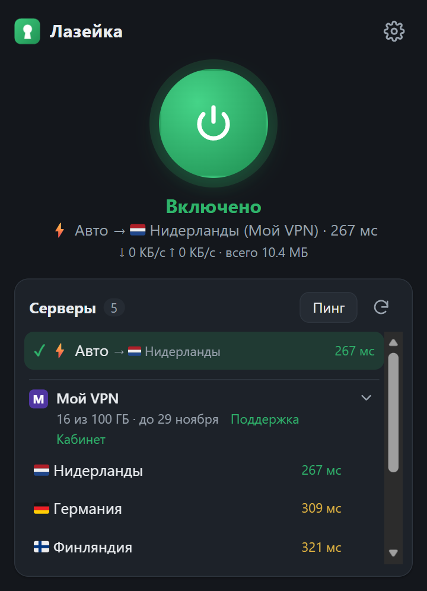</td>
<td valign="top">

**«Ядро mihomo не запущено».** Нажми **«Запустить ядро»**. Не помогло — нажми **«Скопировать команду»**, потом **Win + R**, **Ctrl + V**, **Enter**. Или просто перезагрузи компьютер — ядро стоит в автозагрузке.

**«Неверный secret».** Открой в Блокноте `%LOCALAPPDATA%\Lazeyka\core\config.yaml` и скопируй значение после `secret:` (без кавычек) в настройки Лазейки.

**Подписка с красной плашкой «⚠ …» вместо серверов.** Она не скачалась, в плашке — почему. Если сайт подписки заблокирован в твоей сети, Лазейка сама скачает её через серверы других подписок (рядом появится «через VPN»). Если других рабочих серверов нет — нажми **«Скачать через VPN»**, когда они появятся.

</td>
</tr></table>

| Что видишь | Что делать |
|---|---|
| «⚠ Сайт … не отвечает из этой сети — похоже, он здесь заблокирован» | Сайты VPN-сервисов часто блокируют. Лазейка сама пробует скачать такую подписку через VPN. Проверить: открой ссылку на подписку в браузере, пока Лазейка **выключена**, — если страница не открывается (соединение сброшено), сайт заблокирован в этой сети. |
| «⚠ … ответил «не найдено» (404)» | Ссылка устарела, подписка удалена или закончилась, либо у подписки лимит устройств и он исчерпан (Лазейка — отдельное устройство, как телефон). Удали лишнее устройство в кабинете провайдера или возьми свежую ссылку. |
| «⚠ … отказал в доступе (403)» | Панель не пускает из этой сети или страны. Лазейка попробует через VPN; если не выйдет — спроси у провайдера. |
| «…это ключ одного сервера, а нужна ссылка на подписку» | Ты вставил строку `vless://…` или `vmess://…`. Нужна ссылка вида `https://…/sub/…` — см. [Что понадобится](#что-понадобится). |
| «Все серверы недоступны», у всех серверов «нет ответа» | Серверы недоступны из этой сети, или подписка закончилась. Напиши тому, кто дал подписку. |
| «⚡ Авто подбирает сервер…» | Это пара секунд после включения или смены настроек — Лазейка проверяет серверы. |
| «Прокси занят другим расширением» | В браузере включено ещё одно VPN- или прокси-расширение. Отключи его на странице расширений — управлять прокси может только одно. |
| «Прокси заблокирован политикой» | Компьютер рабочий: администратор запретил расширениям менять прокси. Тут ничего не сделать. |
| Один конкретный сайт не открывается | Открой его, нажми на значок Лазейки и выбери **«Напрямую»** (или наоборот **«Через VPN»**). |
| Звонки в браузере (Телемост, VK Звонки) хрипят | ⚙ → сними галочку «Защита от утечки IP через WebRTC». |
| Сочетание Alt + Shift + L не работает | Его занял другой ярлык. ⚙ → «Горячая клавиша» → «Изменить». |
| «Обновить» показывает команду вместо обновления | Один раз выполни показанную команду (Win + R → Ctrl + V → Enter), потом нажми «Перезапустить». |
| «Лазейка загружена не из папки установщика» | Удали Лазейку на странице расширений и загрузи заново из `%LOCALAPPDATA%\Lazeyka\extension`. Настройки перенеси строкой (см. [перенос](#перенос-на-другой-компьютер)). |
| При установке красный текст «irm не является…» | Команду вставили в «Командную строку», а нужен «Терминал» / PowerShell — см. [шаг 1](#шаг-1-установи-ядро-одной-командой). |
| При установке ошибка скачивания mihomo | GitHub недоступен из этой сети. Скачай на другом компьютере `mihomo-windows-amd64-compatible-….zip` со [страницы релизов](https://github.com/MetaCubeX/mihomo/releases), распакуй и положи файл как `%LOCALAPPDATA%\Lazeyka\core\mihomo.exe`, затем повтори команду. |
| Антивирус ругается на `mihomo.exe` | Некоторые антивирусы настороженно относятся к любым прокси-программам. mihomo — проект с открытым кодом, скачивается с официального GitHub. Если антивирус убрал файл — верни его из карантина или повтори установку. |

Не помогло — заведи [issue](https://github.com/DUFUSxD/lazeyka/issues) и опиши, что видишь (скриншот окна Лазейки очень поможет). Подробная диагностика для тех, кто не боится PowerShell, — в [docs/troubleshooting.md](docs/troubleshooting.md).

## Удаление

1. На странице расширений (`chrome://extensions` / `edge://extensions`) нажми у Лазейки **«Удалить»**. Браузер сразу вернёт обычные настройки сети.
2. Открой **Терминал** (Win + X) и выполни:
   ```powershell
   Get-Process mihomo -ErrorAction SilentlyContinue | Where-Object Path -like "$env:LOCALAPPDATA\Lazeyka\*" | Stop-Process -Force
   Remove-ItemProperty HKCU:\Software\Microsoft\Windows\CurrentVersion\Run LazeykaMihomo -ErrorAction SilentlyContinue
   'Google\Chrome', 'Microsoft\Edge', 'Chromium', 'Yandex\YandexBrowser', 'BraveSoftware\Brave-Browser' | ForEach-Object { Remove-Item "HKCU:\Software\$_\NativeMessagingHosts\com.lazeyka.host" -ErrorAction SilentlyContinue }
   Remove-Item "$env:LOCALAPPDATA\Lazeyka" -Recurse -Force
   ```

## Безопасность и приватность

- **Подписки никуда не уходят.** Они хранятся только в твоём браузере и в ядре на твоём компьютере. Никакой статистики, аккаунтов и серверов «Лазейки» нет.
- **Ядро доступно только с этого компьютера** и только по случайному secret — сайты из интернета не могут им управлять.
- **Без «утечек».** Если ядро упало или все серверы недоступны, сайты, которые должны идти через VPN, просто не откроются — они не пойдут в обход с твоим настоящим адресом. Утечку адреса через WebRTC Лазейка тоже закрывает.
- **Обновления только из этого репозитория.** Кнопка «Обновить» умеет ровно три вещи: узнать версию, запустить ядро и скачать новую версию отсюда.
- **Логотипы подписок** загружаются прямо с сайтов твоих панелей, без сторонних сервисов иконок — никто посторонний не узнает, какими VPN ты пользуешься.
- **Идентификатор устройства.** Панелям с лимитом устройств Лазейка сообщает случайный номер, придуманный на этом компьютере, и модель «Lazeyka» — так провайдер видит её отдельным устройством. Ничего о компьютере в нём нет, и строка переноса настроек его не содержит.
- **Тест скорости** скачивает файл с `speed.cloudflare.com` — всегда через VPN-сервер, который проверяешь.
- Код открыт — всё можно проверить.

## Для разработчиков

Как всё устроено, как вносить изменения, тестировать и выпускать версии — в папке [**docs/**](docs/README.md):
[архитектура](docs/architecture.md) · [разработка и тесты](docs/development.md) · [выпуск версии](docs/release.md) · [диагностика](docs/troubleshooting.md) · [почему сделано так](docs/decisions.md).

## Спасибо

- [MetaCubeX/mihomo](https://github.com/MetaCubeX/mihomo) — ядро, которое делает всю работу с серверами.
- [itdoginfo/allow-domains](https://github.com/itdoginfo/allow-domains) — список заблокированных в РФ сайтов.
- Флаги стран — графика [Twemoji](https://github.com/twitter/twemoji) (© Twitter, [CC-BY 4.0](https://creativecommons.org/licenses/by/4.0/)) в виде шрифта из [country-flag-emoji-polyfill](https://github.com/talkjs/country-flag-emoji-polyfill) (MIT).

## Лицензия

[MIT](LICENSE) — можно свободно пользоваться, менять и распространять, сохраняя упоминание автора. Нашёл уязвимость — напиши приватно, как описано в [SECURITY.md](SECURITY.md). Вопросы и идеи — в [обсуждениях](https://github.com/DUFUSxD/lazeyka/discussions).
