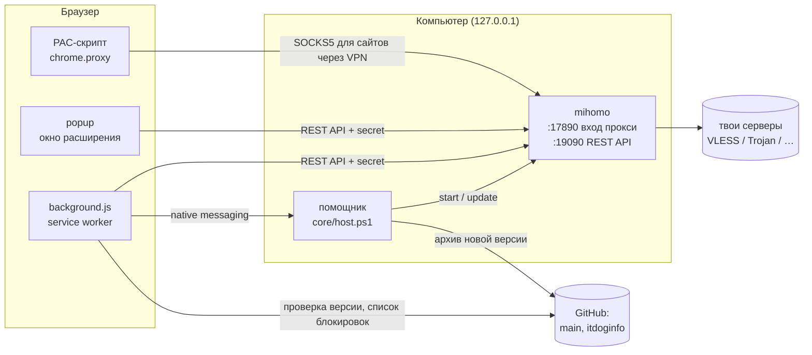
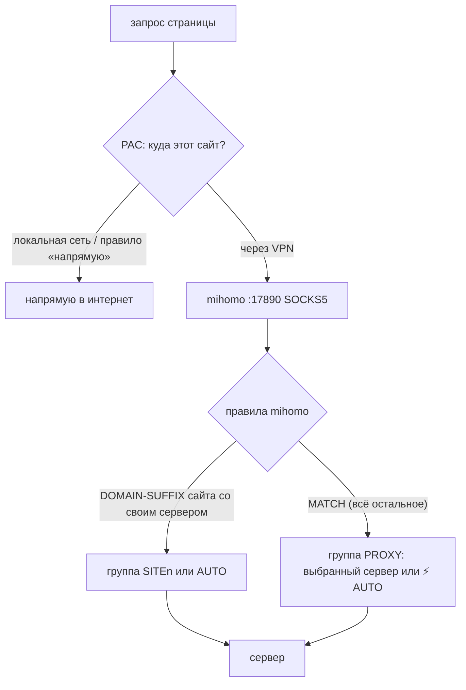
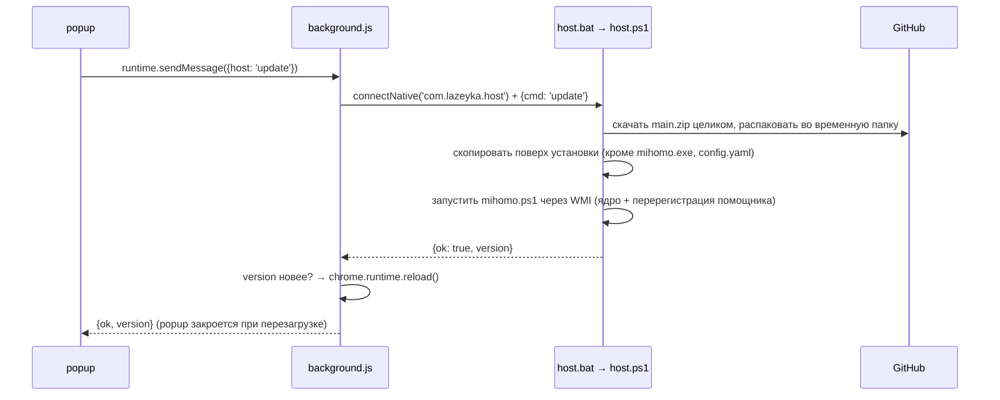

# Архитектура

## Три части

1. **Расширение** (`extension/`) решает, *какой сайт куда идёт*, и управляет ядром. Само VLESS и прочие протоколы оно не умеет: расширениям Chromium доступны только HTTP- и SOCKS-прокси.
2. **Ядро mihomo** (бывший Clash.Meta) — отдельная программа на этом же компьютере. Скачивает подписки, держит соединения с серверами, выбирает живой сервер. Слушает только `127.0.0.1`.
3. **Помощник** (`core/host.ps1`) — короткоживущий процесс, который браузер запускает по запросу расширения для двух вещей, недоступных расширению: запустить ядро и обновить файлы Лазейки.

## Как идёт трафик

### Шаг 1. Браузер: PAC-скрипт

`applyProxy()` в `lib.js` ставит `chrome.proxy` в режим `pac_script` с `mandatory: true`. Текст PAC собирает `buildPac()` из настроек; функции `match`, `isLan`, `decide` встраиваются в него через `toString()` — поэтому в них нельзя ссылаться ни на что снаружи.

Порядок решения (`decide`), первое совпадение побеждает:

| # | Правило | Результат |
|---|---|---|
| 1 | `isLan`: без точки, `*.local`, `*.lan`, `*.home.arpa`, `10.*`, `127.*`, `192.168.*`, `172.16–31.*`, `169.254.*`, `::1`, `fe80:`, `fc/fd` | напрямую |
| 2 | свои списки: «Всегда через VPN», «Всегда напрямую», домены со своим сервером (всегда VPN) — **побеждает самый точный домен** | как указано |
| 3 | список заблокированного в РФ (если включён) | VPN |
| 4 | российские зоны и сервисы (`RU` в `lib.js`, если включено) | напрямую |
| 5 | «Остальные сайты» | VPN или напрямую |

Ответ PAC — либо `DIRECT`, либо `SOCKS5 127.0.0.1:17890` **без** запасного `; DIRECT`: если ядро недоступно, сайт не откроется, а не пойдёт мимо VPN (kill switch). Через SOCKS5 Chromium отдаёт ядру имя сайта, DNS резолвится на стороне сервера.

### Шаг 2. Ядро: группы и правила

Конфиг ядра целиком генерирует `buildConfig()` и заливает `pushConfig()` через `PUT /configs?force=true` (JSON — валидный YAML).

| Группа | Тип | Состав | Зачем |
|---|---|---|---|
| `PROXY` | select | `REJECT`, `AUTO`, все серверы | то, что выбрано в списке серверов |
| `AUTO` | url-test | `REJECT`, все серверы | ⚡ Авто: самый быстрый живой; проверка по настройке «Проверять серверы» (`pingInterval`, по умолчанию 300 с), `lazy: false` |
| `SPEED` | select | `REJECT`, все серверы | тест скорости: `speedTest` выбирает тут проверяемый сервер, не трогая `PROXY` |
| `SITE0…n` | select | `REJECT`, все серверы | по одной на сервер, выбранный для каких-то сайтов |

`REJECT` всегда стоит первым: если подписка не скачалась или все серверы мертвы, группа выбирает блокировку, а не встроенный `COMPATIBLE`, который mihomo подставляет в пустую группу и который на деле = напрямую.

Правила: первым `DOMAIN-SUFFIX,speed.cloudflare.com,SPEED`, затем `DOMAIN-SUFFIX,<домен>,<SITEn|AUTO>` для сайтов со своим сервером (отсортированы от длинных доменов к коротким — mihomo берёт первое совпадение, а должно быть «самый точный»), в конце `MATCH,PROXY`. В PAC `speed.cloudflare.com` всегда «через VPN», иначе тест мерил бы свой интернет.

Подписки — `proxy-providers` с `type: http`, `interval` = `profile-update-interval` провайдера (часы, 1–168) или 3600 с, `proxy: DIRECT` (или `AUTO`, если включено «Качать подписки через VPN» или эта подписка не скачалась напрямую и попала в `subsViaVpn`). `header`: `x-hwid` (случайный `hwid` из хранилища), `x-device-os: Windows`, `x-device-model: Lazeyka` — без `x-hwid` панели с лимитом устройств (Remnawave) отвечают 404. При нескольких подписках к именам серверов добавляется префикс `1| `, `2| `, чтобы одинаковые имена не склеились.

## Расширение ↔ ядро

REST API на `127.0.0.1:19090`, заголовок `Authorization: Bearer <secret>`.

| Вызов | Где | Зачем |
|---|---|---|
| `PUT /configs?force=true` `{payload}` | `pushConfig` | залить конфиг |
| `PUT /proxies/SITEn` `{name}` | `pushConfig` | после заливки выставить серверы для сайтов (иначе там REJECT) |
| `GET /group/AUTO/delay` ×2 | `pushConfig` | сбросить 10-секундный кэш url-test, см. [decisions.md](decisions.md#авто-после-перезаливки) |
| `GET /proxies/PROXY` | `ensureConfig`, `health` | есть ли наш конфиг (404 = ядро перезапускалось), что выбрано |
| `GET /proxies/AUTO` | `health` | на каком сервере сейчас Авто |
| `GET /providers/proxies` | `health` | живость и задержки серверов из health-check; какие серверы в какой подписке; трафик и срок (`subscriptionInfo` из заголовка `Subscription-Userinfo`) |
| `PUT /proxies/PROXY` `{name}` | `selectServer` | выбор сервера в списке |
| `GET /group/PROXY/delay` | кнопка «Пинг» | проверить все серверы сейчас |
| `PUT /providers/proxies/subN` | кнопка ⟳ | перекачать подписку |
| `PUT /proxies/SPEED` `{name}` | `speedTest` | какой сервер проверяем (нет группы — конфиг старый, `pushConfig` и ещё раз) |
| `GET /traffic` (поток строк JSON раз в секунду) | popup, пока включено | `up`/`down` — байт/с, `upTotal`/`downTotal` — с запуска ядра |
| `GET /version` | `refreshMeta` | версия ядра для User-Agent `clash.meta/<версия>` |

### Данные от провайдера

Служебные заголовки подписки (`profile-title`, `support-url`, `profile-web-page-url`, `announce`, `profile-update-interval`, `new-url`/`new-domain`) mihomo наружу не отдаёт, поэтому `refreshMeta` (из `background.js`) скачивает подписку сам:

- только для сайтов панелей, на которые выдано **необязательное** разрешение (`optional_host_permissions`, кнопка «Разрешить» в настройках — `chrome.permissions.request` первым делом в обработчике клика);
- с `deviceHeaders(hwid)` — тот же `x-hwid`, что у ядра, чтобы не занять второе место в лимите устройств;
- панели отдают заголовки только клиентам, а браузеру — HTML-страницу. `fetch` не может поменять `User-Agent`, поэтому сессионное правило `declarativeNetRequest` ставит `clash.meta/<версия>` для запросов к этим сайтам **вне вкладок** (`tabIds: [TAB_ID_NONE]`) — открытая во вкладке панель выглядит как обычно (проверено в Edge);
- тело ответа не читается; `parseSubMeta` берёт только текст (base64 раскодируется, управляющие символы — отказ) и http(s)-ссылки; popup выводит их через `textContent`/`href`. `new-url` принимается только https → https.

Результат — `subMeta[ссылка]`. Сменился адрес — `migrateSub` переписывает ссылку во всех ключах, уведомление, `pushConfig`; сменился интервал — тоже `pushConfig`.

**Стартовый `config.yaml`** (его пишет `mihomo.ps1`) содержит только порты, secret и правило `MATCH,REJECT`. Залитый расширением конфиг живёт в памяти ядра и **теряется при перезапуске ядра** — поэтому `background.js` раз в минуту и popup при открытии вызывают `ensureConfig`: если группы `PROXY` нет (404), конфиг заливается заново. До этого момента всё блокируется (`MATCH,REJECT`), а не идёт напрямую.

## Расширение ↔ помощник

- Протокол Chrome: 4 байта длины + JSON в stdin/stdout. В stdout помощника не должно попадать ничего, кроме ответа.
- Команды строго из списка: `ping` (версия), `start` (запустить ядро), `update`. Адрес репозитория зашит в `host.ps1`, из сообщения ничего не берётся.
- Браузер пускает только расширение, чей ID указан в `core\host.json` → `allowed_origins`. ID распакованного расширения Chromium считает из пути к папке, `mihomo.ps1` повторяет эту формулу (`Get-ExtId`).
- Регистрация: ключи `HKCU\Software\<браузер>\NativeMessagingHosts\com.lazeyka.host` для Chrome, Edge, Chromium, Яндекса, Brave; значение по умолчанию — путь к `host.json`. Edge находит помощника и по ключу Chrome.

## Фоновые задачи (`background.js`)

| Таймер | Период | Что делает |
|---|---|---|
| `sync` | 1 мин | `ensureConfig` + `health`; значок (зелёный / серый / красный «!»); уведомления при смене состояния: выбранный сервер не отвечает, все мертвы, ядро не запущено; подписка истекает (< 3 дней) / истекла / трафик ≥ 90% — по одному разу на событие (`subStatus`, ключи в `alerted`) |
| `meta` | 1 ч, а также при выдаче разрешения и после «Сохранить» | `refreshMeta` — данные от провайдера, переезд подписки |
| `blocked` | 6 ч | скачать список itdoginfo (меньше 100 доменов — считаем битым, оставляем старый) |
| `update` | по настройке «Искать обновления» (`updateEvery`, по умолчанию 6 ч; `0` — таймера нет и при запуске GitHub не дёргается) | `checkUpdate`: версия из `main/extension/manifest.json`, заметки из `main/CHANGELOG.md`; одно уведомление на версию |

Таймеры создаются только в `onInstalled`/`onStartup`: повторное создание при каждом пробуждении service worker сбрасывало бы 6-часовые таймеры.

## Хранилище

`chrome.storage.local`:

| Ключ | Что | Попадает в экспорт |
|---|---|---|
| `subs` | ссылки на подписки | ✅ |
| `subNames` | `{ссылка: своё название}` — без названия показывается домен панели | ✅ |
| `pingInterval` | секунды между проверками серверов (`PING_OPTIONS`) | ✅ |
| `updateEvery` | минуты между проверками обновлений, `0` — вручную (`UPDATE_OPTIONS`) | ✅ |
| `secret` | secret ядра (свой на каждом компьютере) | ❌ |
| `rest` | `vpn` / `direct` — «Остальные сайты» | ✅ |
| `ruDirect`, `useBlocked`, `webrtc`, `subViaVpn` | галочки в настройках | ✅ |
| `subsViaVpn` | ссылки подписок, которые не скачались напрямую и качаются через ⚡ Авто (заполняет `refreshSubs`) | ❌ — своё для каждой сети |
| `vpnList`, `directList` | свои списки доменов | ✅ |
| `siteServers` | `{домен: имя сервера или 'AUTO'}` | ✅ |
| `sortServers` | `sub` / `ping` / `name` — порядок серверов (`SORT_OPTIONS`) | ✅ |
| `hideDead`, `pingOnOpen` | галочки «Список серверов» | ✅ |
| `collapsed` | ссылки подписок, свёрнутых в списке серверов | ❌ |
| `blocked`, `blockedAt` | список itdoginfo и время загрузки | ❌ |
| `hwid` | случайные 32 hex-символа — «устройство» для панелей с лимитом | ❌ — свой на каждом компьютере |
| `subMeta` | `{ссылка: {title, support, web, announce, updateHours, newUrl, fetchedAt}}` | ❌ |
| `alerted` | о каких событиях подписок уже уведомили (последние 50) | ❌ |
| `newsSeen` | закрытые сообщения провайдеров (последние 20) | ❌ |
| `update` | `{latest, notes, checkedAt}` — результат проверки обновлений | ❌ |
| `notifiedVersion`, `dismissedVersion` | о какой версии уже уведомили / «Позже» | ❌ |

popup при «Сохранить» не перезаписывает `hwid`, `subMeta`, `alerted` — их ведёт `background.js`.

`chrome.storage.session`: `last` — последнее состояние здоровья (чтобы уведомлять при смене, а не каждую минуту); `lastPing` — когда popup последний раз пинговал при открытии.

Строка переноса настроек: `LZK1:` + base64url(JSON) из ключей с ✅. При импорте берутся только известные ключи нужного типа, всё прогоняется через те же нормализаторы.

## Порты и имена

| Что | Значение | Где задано |
|---|---|---|
| Вход прокси (mixed: SOCKS5 + HTTP) | `127.0.0.1:17890` | `PORT` в `lib.js`, `config.yaml` |
| REST API ядра | `127.0.0.1:19090` | `CONTROLLER` в `lib.js`, `config.yaml`, `host_permissions` в `manifest.json` |
| Имя помощника | `com.lazeyka.host` | `HOST` в `lib.js`, `mihomo.ps1` |
| Автозагрузка ядра | `HKCU\…\Run\LazeykaMihomo` | `mihomo.ps1 -Autostart` |
| Health-check | `https://cp.cloudflare.com/generate_204` | `TEST_URL` в `lib.js` |
| Тест скорости | `https://speed.cloudflare.com/__down?bytes=25000000`, не дольше 8 с | `SPEED_HOST`, `speedTest` в `lib.js`, `host_permissions` |
| Список заблокированного | `itdoginfo/allow-domains/main/Russia/inside-raw.lst` | `BLOCKED_URL` в `lib.js` |
